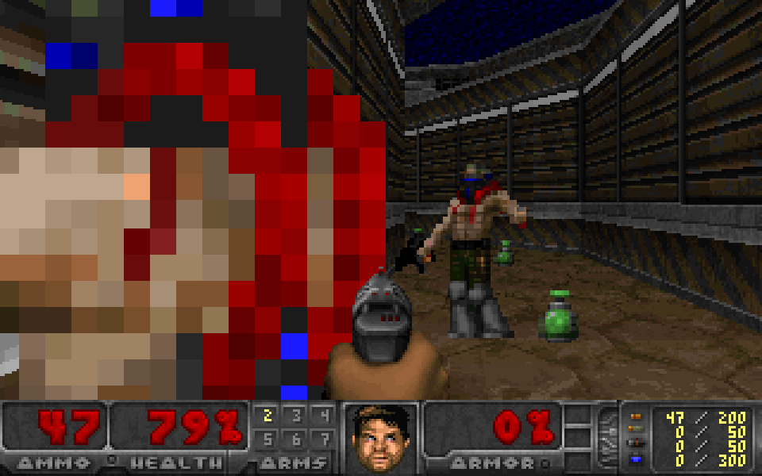

# logfire-doom

Doom, rendered by [Pydantic Logfire](https://pydantic.dev/logfire). Each frame is one SQL query sent to Logfire's `POST /v2/query` endpoint. The map, the textures and the sprites are stored in Logfire as spans.



## How it works

- **The renderer is one SQL query.** It is [SailDoom](https://github.com/querygraph/saildoom)'s Spark SQL port of [SQLDoom](https://github.com/cedardb/sqldoom)'s renderer, translated to DataFusion SQL by `port.py`. The result is `renderer_df.sql` (48 KB, about 90 CTEs).
- **The data is telemetry.** `pack.py` packs Freedoom's E1M1 tables into 90,692 rows, and `ingest.py` sends each row as a span named `doom.<table>` with the columns as attributes. Texels are packed 256 to a row, one character per texel.
- **The query reads its tables from `records`.** `build.py` adds one CTE per table that reads `attributes` and casts each column. The complete query, `frame_ff.sql`, is 65 KB.
- **A frame comes back as 201 rows.** There is one row of hex colours per scanline, and one row with the floor height below the camera.
- **The client only moves the camera.** `play.py` serves a page on localhost. Each key press sends one query. There is no collision and no game logic, so you can walk through walls and the monsters do not move.

A frame takes about 1.5 s on Logfire and about 0.4 s on local DataFusion. The two renders are pixel-identical.

## Play it in the browser

The page in `docs/` is published with GitHub Pages. It sends each camera pose to a Cloudflare Worker (`worker/`), which holds the Logfire read token, fills the pose into the SQL, and calls `/v2/query`. Visitors can only choose the pose, not the SQL, and each IP gets 40 frames a minute.

Deploy the Worker with OpenTofu (`infra/`). The Cloudflare API token needs "Workers Scripts: Edit" on the account.

```sh
cd infra
export CLOUDFLARE_API_TOKEN=...
tofu init
tofu apply -var account_id=... -var workers_subdomain=... -var doom_read_token=...
```

Then put the `worker_url` output in `docs/config.js`. In the repository settings, set Pages to deploy from GitHub Actions; `.github/workflows/pages.yml` publishes `docs/` on each push to `main`.

To test the Worker locally, put `DOOM_READ_TOKEN=...` in `worker/.dev.vars`, run `npx wrangler dev --var ALLOWED_ORIGIN:'*'` in `worker/`, and open `docs/index.html?worker=http://localhost:8787`.

## Run it locally

Without Logfire, on local DataFusion:

```sh
DOOM_LOCAL=1 uv run --no-project --with datafusion --with pillow play.py
```

On Logfire, put these in `.env`, then ingest one time and play:

```
DOOM_LOGFIRE_URL=https://logfire-us.pydantic.dev
DOOM_SERVICE=doom-e1m1
DOOM_WRITE_TOKEN=...
DOOM_READ_TOKEN=...
```

```sh
set -a; . ./.env; set +a
uv run --no-project --with httpx --with pyarrow ingest.py doom-e1m1
uv run --no-project --with httpx --with pillow play.py
```

Open http://localhost:8666. W and S move, A and D strafe, Q and E or the arrow keys turn, Shift runs.

## Rebuild the SQL

`port.py` needs a checkout of SailDoom, and `pack.py` needs SailDoom's per-map Parquet cut (`engine.cut_map`) of its `play-data-1` release.

```sh
python port.py /path/to/saildoom renderer_df.sql
python pack.py /path/to/freedoom1/maps/1 renderer_df.sql packed
python build.py renderer_df.sql packed frame_local.sql frame_ff.sql   # also writes worker/src/frame.sql
```

## Licence

GPL-2.0-or-later, as SQLDoom and SailDoom. SQLDoom is Copyright (C) 2026 CedarDB GmbH. The renderer keeps SQLDoom's structure and arithmetic. The data in `packed/` comes from [Freedoom](https://freedoom.github.io/), under the BSD-3-Clause licence in `LICENSE-freedoom.txt`.
